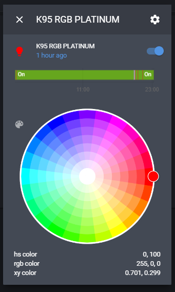

# iCUE2HA [](https://lbesson.mit-license.org/)
Corsair iCUE ↔ Home Assistant, over MQTT

*Project Description*

A C# .NET core Windows service, allowing Home Assistant to discover and control the LED color and brightness of Corsair iCUE devices installed on the host system over MQTT. Each iCUE device will be discovered as a separate RGB LED light bulb.

It can also **switch the iCUE lighting profile** from Home Assistant, for example when a game starts. Both Corsair SDKs are used by this single service: the *iCUE SDK* for the colors and the *Game SDK* for the profiles, so there is no second program to install and keep running. See *Profiles and manual mode* below.

> Work in progress: the goal is a one-click installer and a small tool to manage the profiles. Today the service is built and deployed with `deploy.cmd`, and `CgSDK.x64_2015.dll` has to be fetched once (see *Profiles: the details*).

*What you need on the PC, once*

| Item | What it is for | Notes |
|---|---|---|
| **iCUE** (Corsair) | The only software that talks to the devices: everything goes through it | Settings → SDK: turn on both **iCUE SDK** and **Game SDK** |
| **.NET Core 3.1 SDK** | Builds the service; it also brings the runtime the service needs | [dotnet-sdk-3.1](https://download.visualstudio.microsoft.com/download/pr/854ca330-4414-4141-9be8-5da3c4be8d04/3792eafd60099b3050313f2edfd31805/dotnet-sdk-3.1.101-win-x64.exe) |
| **Git and a clone of this repository** | Getting and updating the code | `git clone https://github.com/Relyld/iCUE2HA` |
| **`CgSDK.x64_2015.dll`** | Corsair's Game SDK library, needed for the profiles only | Download the [Open CUE Service](https://github.com/Legion2/open-cue-service/releases) release, extract it and keep that one file. You do not need to run that program. |
| **Your iCUE profiles** | What the Home Assistant select will offer | Exported into `C:\ProgramData\Corsair\CUE5\GameSdkEffects\profiles`, listed in `priorities.cfg` |
| **A Windows service** | Runs the converter at boot | Created once, see *First setup* below |

*What you need in Home Assistant, once*

* An **MQTT broker**, in practice the **Mosquitto broker** add-on.
* The **MQTT integration**, pointed at that broker.
* Write down the broker IP address and credentials: they go into `properties.json`.

*What has to keep running*

1. **iCUE** - nothing works while it is closed.
2. **The `icue2mqttService` service** - automatic (delayed) start.
3. **The MQTT broker and Home Assistant**, on your Home Assistant machine.

Nothing else. In particular, **do not run `open-cue-service.exe` or `open-cue-cli`**: this service drives the Game SDK itself, and two programs asking for the Game SDK at the same time fight over it. Only the `.dll` from that release is needed.

*First setup, in order*

1. Install iCUE, turn both SDKs on, and restart it.
2. Create the `profiles` directory, export your profiles into it and write `priorities.cfg`, one `Name=priority` line per profile. Writing in `ProgramData` needs administrator rights.
3. Clone the repository and put `CgSDK.x64_2015.dll` at its root; `deploy.cmd` picks it up and keeps it from then on.
4. Run `deploy.cmd`. It builds the project, fills `C:\MQTT`, and tells you the service does not exist yet.
5. Edit `C:\MQTT\properties.json`: set `mqttUrl` to the broker IP, and the credentials if your broker needs them.
6. Create the service from an **administrator** PowerShell. The spaces after the `=` signs are required:
   ```
   sc.exe create icue2mqttService binPath= "C:\MQTT\icue2mqtt.exe" start= delayed-auto
   sc.exe start icue2mqttService
   ```
7. Check the log:
   ```
   Get-WinEvent -LogName icue2mqttLog -MaxEvents 20 | Sort-Object TimeCreated | Format-List TimeCreated,Message
   ```
   You should see `Connected to MQTT broker`, `iCUE profiles read from ...` with your profile names, `Game SDK connected`, then one `Publishing device ...` per device.
8. Look for the entities in Home Assistant. If auto-discovery does not show them, use the YAML below.

*properties.json*

| Property | Meaning |
|---|---|
| `mqttUrl` | IP address of the MQTT broker, required |
| `mqttCredentialsUser`, `mqttCredentialsPwd` | Broker credentials, leave empty when not needed |
| `mqttOverridePort` | Broker port, when it is not the default one |
| `logPath` | File used for logging before the Windows event log is available |
| `profilesDirectory` | Name of the Game SDK profiles directory, `profiles` by default |
| `gameSdkEffectsPath` | Full path of the `GameSdkEffects` directory, empty to detect the installed iCUE |
| `autoManualMode` | `false` stops a light command from switching back to `Manual` |

*Updating / quick redeploy*

Once the service is installed, `deploy.cmd` (or `deploy.ps1`) at the root of the repository rebuilds the project and redeploys it in one step: it publishes to a temporary folder, stops the service, empties the deployment folder (default `C:\MQTT`) while keeping your `properties.json`, copies the new build and restarts the service. It asks for administrator rights by itself.
* `deploy.cmd -Pull` runs `git pull --ff-only` first
* `.\deploy.ps1 -Destination D:\icue2mqttRelease -ServiceName icue2mqttService` to use another folder or service name

*Profiles and manual mode*

The service publishes, besides the lights, a **select** entity named `iCUE Profile` (`select.icue_profile`). Its options are:

| Option | Who draws the lighting | What happens |
|---|---|---|
| `Manual` | this service | Every profile is cleared and the Game SDK control is released. The color and brightness set on the lights in Home Assistant are shown, over iCUE's own lighting. |
| `iCUE` | iCUE | Every profile is cleared and this service steps back: iCUE shows its own configuration. |
| *a profile name* | the profile | The profile is activated through the Game SDK and this service steps back. |

The select (and the existing `iCue Control` switch, where ON = `Manual` and OFF = `iCUE`) follow what the service is doing:
* sending a color, a brightness or ON/OFF to any light switches back to `Manual` (set `"autoManualMode": false` in `properties.json` to disable this);
* profiles added to or removed from `priorities.cfg` are picked up within 30 seconds, no restart needed;
* when iCUE is restarted the service reconnects and puts the selected profile back on;
* the Game SDK control is only held while a profile is actually active, so it stays out of the way of the colors sent from Home Assistant.

Home Assistant automation example, driven by the Steam integration:
```yaml
automation:
  - alias: "iCUE profile when a game starts"
    trigger:
      - platform: state
        entity_id: sensor.steam_mynick
        to: "Cyberpunk 2077"
    action:
      - service: select.select_option
        target: { entity_id: select.icue_profile }
        data: { option: "Neon" }
  - alias: "Back to normal when the game stops"
    trigger:
      - platform: state
        entity_id: sensor.steam_mynick
        from: "Cyberpunk 2077"
    action:
      - service: select.select_option
        target: { entity_id: select.icue_profile }
        data: { option: "iCUE" }
```

*Profiles: the details*

Profile switching uses the Corsair **Game SDK**, whose library `CgSDK.x64_2015.dll` is supplied by Corsair under its own terms and is therefore **not** distributed with this project. Without it the service still works, the select simply offers `Manual` and `iCUE` only.
* `deploy.cmd` keeps the library across redeployments and looks for an existing copy by itself; `deploy.cmd -GameSdkDll <path>` points it at one.
* `priorities.cfg` holds one `Name=priority` line per profile, with unique priorities and names made of `a-z A-Z _` only. Leading spaces are ignored by this service.
* Export each profile from iCUE with only *Lighting Effects* checked; the name cannot be changed after the export.
* The profile names read from `priorities.cfg` are written to the service log at startup: they are exactly the options offered in Home Assistant.

If MQTT auto-discovery does not show the entities in your Home Assistant, the same entities can be declared by hand in `configuration.yaml`:
```yaml
mqtt:
  select:
    - name: "iCUE Profile"
      unique_id: icue2mqtt_profile
      state_topic: "homeassistant/select/icue2mqtt/profile/state"
      command_topic: "homeassistant/select/icue2mqtt/profile/set"
      options: ["Manual", "iCUE", "Nuclear", "Neon", "Poison", "Off"]
  light:
    - name: "Keyboard - Manual"
      unique_id: k100_rgb_manual
      schema: json
      state_topic: "homeassistant/light/icue2mqtt/K100_RGB/state"
      command_topic: "homeassistant/light/icue2mqtt/K100_RGB/set"
      brightness: true
      supported_color_modes: ["rgb"]
```

*Home Assistant*

You will need a MQTT broker. This has been tested with Mosquitto broker on Hass.io
Discovered devices will be listed under integrations>MQTT:<IP> Each iCUE device will be named with the device type and have the entity ID of light.device_type_with_spaces_as_underscores.
Each light has a color and a brightness (0-255) that can be changed independently. The color and brightness are remembered when the light is turned off and restored when it is turned back on.
  


*Tested iCUE Devices*

* K95 RGB Platinum
* VOID Wireless headphones
* Commander Pro
* Should work with any Corsair devices compatible with the SDK

*Limitations*

* While in `Manual` mode the iCUE software cannot override the colors set from Home Assistant. Select `iCUE` (or turn the `iCue Control` switch OFF) to give the lighting back to iCUE.
* How the lighting of a profile (Game SDK) stacks with the colors set by this service is decided by iCUE; the service steps back (SDK layer priority 126, below iCUE's own layer 127) as soon as a profile or `iCUE` is selected.
* A Windows service runs in its own session, separate from your desktop session. The iCUE SDK copes with that, the Game SDK is unverified there. If the log says `Game SDK unavailable` while the library is in place and iCUE is running, the converter has to be started at logon instead of as a service.
* When the PC starts up, the iCUE server takes a while to start. The service will re-try to connect every 10 seconds until successful and therefore may not be instantly available.
* When getting the state, the color returned for a device is the average values for R, G, B across all the LEDs on the device as iCUE LEs might all have different colors
* Designed to control an entire device, setting a unified color not able to control each LED individually.

* v 1.0.1
  Updated to new SDK now controls fans with greater LED density
  
*TODO*

* One-click installer
* Small tool to add and edit the profiles (`priorities.cfg` and profile files)
* Move to a currently supported .NET (3.1 is end of life)

*Suggestions*

Please feel free to give feedback or feature requests

*Thanks*

Based on the original icue2mqtt project by tobinbrooke (MIT license, see LICENSE).

The Game SDK bindings are derived from the [Open CUE Service](https://github.com/Legion2/open-cue-service) by Legion2 (Apache License 2.0), see [NOTICE](NOTICE).

https://dotnetcoretutorials.com/2019/09/19/creating-windows-services-in-net-core-part-1-the-microsoft-way/
https://github.com/AndrewBabbitt97/CUESDK.NET


