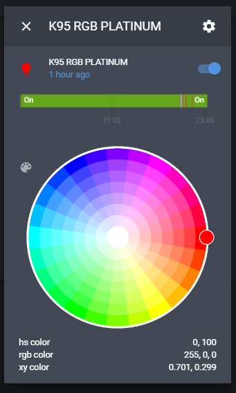

# iCUE2HA [](https://lbesson.mit-license.org/)
Corsair iCUE ↔ Home Assistant, over MQTT

*Project Description*

A C# .NET core Windows service, allowing Home Assistant to discover and control the LED color and brightness of Corsair iCUE devices installed on the host system over MQTT. Each iCUE device will be discovered as a separate RGB LED light bulb.

It can also **switch the iCUE lighting profile** from Home Assistant (for example when a game starts), through the [Open CUE](https://github.com/Legion2/open-cue-service) service. See *Profiles and manual mode* below.

> Work in progress: the goal is a single, simple installer (service + Open CUE + a small profile manager). Today the service has to be built and deployed with `deploy.cmd`, and Open CUE installed separately.

*prerequisites*

* to build: .Net core SDK https://download.visualstudio.microsoft.com/download/pr/854ca330-4414-4141-9be8-5da3c4be8d04/3792eafd60099b3050313f2edfd31805/dotnet-sdk-3.1.101-win-x64.exe
* to run: .NET core 3.1 runtime https://download.visualstudio.microsoft.com/download/pr/a1d41522-4da0-42bc-b3f2-e4b7d842974d/03101425368c87c55c1fe7cafbb4e0fb/windowsdesktop-runtime-3.1.1-win-x64.exe

*Installing*

there are currently no installers. The repository will need to be cloned and built/installed manually:
* Run PowerShell as administrator
* CD to the icue2mqtt directory of the cloned repository
* Run "dotnet publish -r win-x64 -c Release"
* Open the icue2mqtt/bin/release/netcoreapp3.1/win-x64/publish directory
* Copy all the files to a suitable deployment directory for the following points we will assume this is C:\icue2mqttRelease
* Edit the C:\icue2mqttRelease\properties.json in a suitable text editor
* Set the mqttUrl property value to the IP of your MQTT broker
* If you MQTT server requires authentication then 
* CD to the deployment directory set the mqttCredentialsUser and mqttCredentialsPwd property values
* Run "sc.exe create icue2mqttService BinPath=C:\icue2mqttRelease\icue2mqtt.exe" in admin PowerShell this will set up a service
* Go to run>services.msc
* Locate the icue2mqttService and double click it
* Change the Startup type to "Automatic (Delayed Start)"
* Start the service
* click Apply
* Click OK

*optional properties.json*

If using non-default MQTT broker add the JSON property mqttOverridePort with the port number

*Updating / quick redeploy*

Once the service is installed, `deploy.cmd` (or `deploy.ps1`) at the root of the repository rebuilds the project and redeploys it in one step: it publishes to a temporary folder, stops the service, empties the deployment folder (default `C:\MQTT`) while keeping your `properties.json`, copies the new build and restarts the service. It asks for administrator rights by itself.
* `deploy.cmd -Pull` runs `git pull --ff-only` first
* `.\deploy.ps1 -Destination D:\icue2mqttRelease -ServiceName icue2mqttService` to use another folder or service name

*Profiles and manual mode*

The service publishes, besides the lights, a **select** entity named `iCUE Profile` (`select.icue_profile`). Its options are:

| Option | Who draws the lighting | What happens |
|---|---|---|
| `Manual` | this service | All Open CUE profiles are deactivated. The color and brightness set on the lights in Home Assistant are shown, over iCUE's own lighting. |
| `iCUE` | iCUE | All Open CUE profiles are deactivated and this service steps back: iCUE shows its own configuration. |
| *a profile name* | the profile | The profile is activated through Open CUE and this service steps back. |

The select (and the existing `iCue Control` switch, where ON = `Manual` and OFF = `iCUE`) are always kept in sync with what is really active:
* sending a color, a brightness or ON/OFF to any light switches back to `Manual` (set `"autoManualMode": false` in `properties.json` to disable this);
* a profile activated from elsewhere (open-cue-cli, another MQTT bridge...) is detected within 30 seconds;
* profiles added to / removed from Open CUE are picked up within 30 seconds, no restart needed.

Home Assistant automation example, driven by the Steam integration:
```yaml
automation:
  - alias: "iCUE profile when a game starts"
    trigger:
      - platform: state
        entity_id: sensor.steam_mynick
        to: "Cyberpunk 2077"
    action:
      - service: select.select_option
        target: { entity_id: select.icue_profile }
        data: { option: "Neon" }
  - alias: "Back to normal when the game stops"
    trigger:
      - platform: state
        entity_id: sensor.steam_mynick
        from: "Cyberpunk 2077"
    action:
      - service: select.select_option
        target: { entity_id: select.icue_profile }
        data: { option: "iCUE" }
```

*Open CUE prerequisites*

Profile switching relies on the iCUE Game SDK, which is only reachable through [Open CUE](https://github.com/Legion2/open-cue-service) (REST API on `http://localhost:25555`, change it with `openCueUrl` in `properties.json`). Without Open CUE the service still works, the select just offers `Manual` and `iCUE`.
* In iCUE, enable the SDK (Settings → *iCUE SDK and Game SDK*).
* Install Open CUE and run it as the logged-in user (not as a Windows service in session 0).
* Profiles live in `C:\ProgramData\Corsair\CUE5\GameSdkEffects\profiles` (iCUE 5) and are listed in `priorities.cfg`, one `Name=priority` per line, **without any leading space**, unique priorities, names made of `a-z A-Z _` only.
* Export the profile from iCUE with only *Lighting Effects* checked; the name cannot be changed after the export.
* Check with `open-cue-cli profile list`: the names shown must be exactly the ones you want to see in Home Assistant.

If MQTT auto-discovery does not show the entities in your Home Assistant, the same entities can be declared by hand in `configuration.yaml`:
```yaml
mqtt:
  select:
    - name: "iCUE Profile"
      unique_id: icue2mqtt_profile
      state_topic: "homeassistant/select/icue2mqtt/profile/state"
      command_topic: "homeassistant/select/icue2mqtt/profile/set"
      options: ["Manual", "iCUE", "Nuclear", "Neon", "Poison", "Off"]
  light:
    - name: "Keyboard - Manual"
      unique_id: k100_rgb_manual
      schema: json
      state_topic: "homeassistant/light/icue2mqtt/K100_RGB/state"
      command_topic: "homeassistant/light/icue2mqtt/K100_RGB/set"
      brightness: true
      supported_color_modes: ["rgb"]
```

*Home Assistant*

You will need a MQTT broker. This has been tested with Mosquitto broker on Hass.io
Discovered devices will be listed under integrations>MQTT:<IP> Each iCUE device will be named with the device type and have the entity ID of light.device_type_with_spaces_as_underscores.
Each light has a color and a brightness (0-255) that can be changed independently. The color and brightness are remembered when the light is turned off and restored when it is turned back on.
  


*Tested iCUE Devices*

* K95 RGB Platinum
* VOID Wireless headphones
* Commander Pro
* Should work with any Corsair devices compatible with the SDK

*Limitations*

* While in `Manual` mode the iCUE software cannot override the colors set from Home Assistant. Select `iCUE` (or turn the `iCue Control` switch OFF) to give the lighting back to iCUE.
* How the lighting of a profile (Game SDK) stacks with the colors set by this service is decided by iCUE; the service steps back (SDK layer priority 126, below iCUE's own layer 127) as soon as a profile or `iCUE` is selected.
* When the PC starts up, the iCUE server takes a while to start. The service will re-try to connect every 10 seconds until successful and therefore may not be instantly available.
* When getting the state, the color returned for a device is the average values for R, G, B across all the LEDs on the device as iCUE LEs might all have different colors
* Designed to control an entire device, setting a unified color not able to control each LED individually.

* v 1.0.1
  Updated to new SDK now controls fans with greater LED density
  
*TODO*

* Supervise Open CUE from the service / one-click installer
* Small tool to add and edit the profiles (`priorities.cfg` and profile files)
* Move to a currently supported .NET (3.1 is end of life)

*Suggestions*

Please feel free to give feedback or feature requests

*Thanks*

Based on the original icue2mqtt project by tobinbrooke (MIT license, see LICENSE).

https://dotnetcoretutorials.com/2019/09/19/creating-windows-services-in-net-core-part-1-the-microsoft-way/
https://github.com/AndrewBabbitt97/CUESDK.NET


